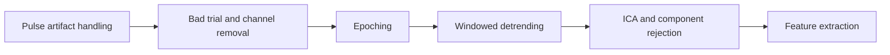

# windowedDetrend

Python and MATLAB tools for windowed detrending of residual capacitive artifacts in epoched TMS-EEG recordings.

The algorithm separates the artifact into rise and decay windows, fits each window independently with exponential or polynomial functions, and subtracts the assembled trend. The default uses **Lagrange rise interpolation and degree-3 polynomial decay**. A non-windowed bi-exponential is provided only as an external comparator.

## Conceptual framework


[Figure PDF](scripts/images/paper_concept_computed.pdf) | [Numerical source](scripts/reconstruct_paper_concept.py) | [Method and interpretation](scripts/POST_EPOCHING_GUIDE.md)

The figure is a computed conceptual example, not a universal ranking of fitting methods. Lagrange interpolation reproduces every observed rise sample, so subtraction leaves zero in that window, including any neural activity. See the guide for model assumptions and comparator limitations.

## Place in the preprocessing pipeline



Input to the core functions is an array of **epochs x channels x samples**, with times in **seconds relative to TMS**. Amplitude units and dimensions are preserved. MNE and EEGLAB adapters are also included.

## Python: run without installing the plugin

Download or clone this repository. From its root, create the environment and open the demonstration notebook:

```bash
cd scripts/PythonPlugin
conda env create -f environment.yml
conda activate windowed-detrend
python -m jupyterlab demo_windowed_detrend.ipynb
```

The notebook imports the local source automatically. Edit sections **A: toy signal** and **B: detrending parameters**, then run all cells.

- [Python notebook with toy signal and plots](scripts/PythonPlugin/demo_windowed_detrend.ipynb)
- [Environment setup, including the venv alternative](scripts/PythonPlugin/ENVIRONMENT.md)
- [Python API and tests](scripts/PythonPlugin/README.md)

For an existing pipeline, use a generic path to your downloaded copy:

```python
import sys
from pathlib import Path

plugin_src = Path("/path/to/windowedDetrend/scripts/PythonPlugin/src")
sys.path.insert(0, str(plugin_src))
from windowed_detrend import Config, detrend

cfg = Config(rise_model="lagrange", decay_model="poly", decay_degree=3,
             refinements=5)
# data and times come from your already preprocessed, epoched recording.
corrected, trend, diagnostics = detrend(data, times, cfg)
```

## MATLAB: run directly from the downloaded files

Open the Live Script and select **Run All**. Edit the opening toy-signal and detrending parameter sections to explore the alternatives.

```matlab
plugin_dir = fullfile('/path/to/windowedDetrend', 'scripts', 'MatlabPlugin');
addpath(plugin_dir);
open(fullfile(plugin_dir, 'demo_windowed_detrend.mlx'));
```

- [MATLAB Live Script](scripts/MatlabPlugin/demo_windowed_detrend.mlx)
- [Readable MATLAB demonstration source](scripts/MatlabPlugin/demo_windowed_detrend_source.m)
- [MATLAB API, EEGLAB adapter and tests](scripts/MatlabPlugin/README.md)

For an existing epoched array:

```matlab
cfg = tmspath_config();
cfg.rise_model = 'lagrange';
cfg.decay_model = 'poly';
cfg.decay_degree = 3;
cfg.refinements = 5;
[corrected, trend, diagnostics] = tmspath_detrend(data, times, cfg);
```

The core requires no additional MATLAB toolbox. The demonstration source was tested with MATLAB R2023b. Run the Live Script to generate its inline outputs. Neither PyPI nor MATLAB File Exchange installation is required.

## Parameters and evaluation

The default onset is 10 ms, the peak is detected automatically within the search interval, and correction extends to the epoch end. Inspect and adjust these settings for your data. Five search refinements apply to optional exponential fits; polynomial fits do not use this setting.

- [Complete defaults, model options, algorithm flowchart and usage examples](scripts/POST_EPOCHING_GUIDE.md)
- [Direct comparison with the original paper's numerical branches](scripts/PAPER_PLUGIN_COMPARISON.md)
- [Supplementary Figure 1, panels A-F, and Python/MATLAB results](scripts/PLUGIN_RESULTS.md)
- [Method alignment and numerical differences](scripts/PAPER_ALIGNMENT.md)
- [Interactive supplementary dashboard](scripts/results/supplement1/dashboard.html): download the repository and open this HTML file locally.

Artifact-fitting MSE and recovery MSE against the known clean oscillator answer different questions. A small fit residual does not alone demonstrate preservation of neural activity. The standalone plugins are adaptations of the original numerical workflow, with documented solver and boundary differences.

## Citation and license

See the [citation metadata](scripts/MatlabPlugin/CITATION.cff) and [AGPL-3.0 license](LICENSE).

### Paper

If you use windowed detrending in your research, please cite:

Vergani, A. A., Peroni, G., Bruscagli, C., Lionti, A., Brandizzi, F., Lenge, M., Salvestrini, G., Jiménez-Jiménez, D., Casarotto, S., Rosanova, M., Mazzoni, A., Guerrini, R., Grippo, A., & Balestrini, S. (2026). **Effective correction of extreme capacitive artifacts in TMS-EEG via windowed detrending.** *Journal of Neural Engineering*, 23(3), 036009. [https://doi.org/10.1088/1741-2552/ae668e](https://doi.org/10.1088/1741-2552/ae668e).
