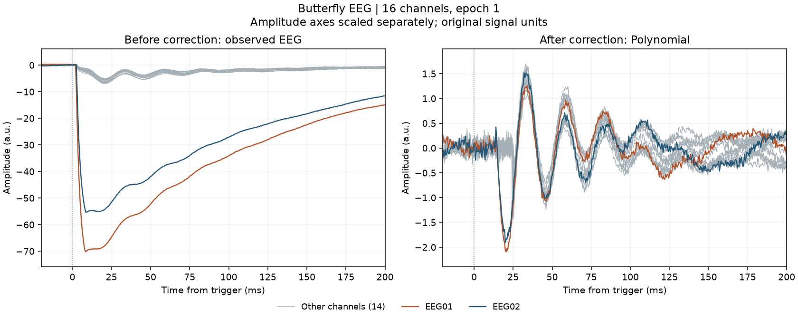
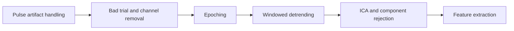
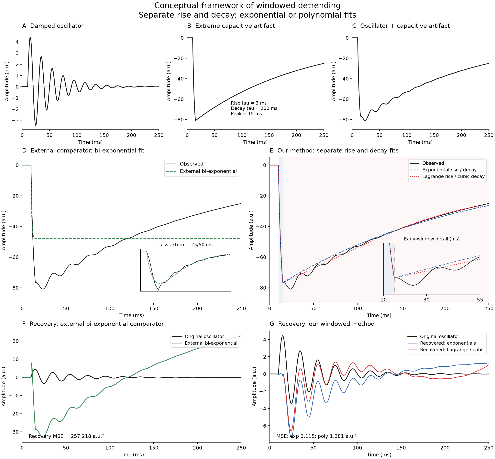

# windowedDetrend

Python and MATLAB tools for windowed detrending of residual capacitive artifacts in epoched TMS-EEG recordings.

The default follows the published Windowed TEP notebook: quadratic pre-onset
fit, Lagrange rise and free polynomial decay. Automatic slope screening decides
whether to use windowed detrending and which decay degree to apply. See
[TEP alignment and validation](scripts/TEP_ALIGNMENT.md).

## Start with these three controls

Keep the published TEP defaults initially and change one control at a time,
in this order. Both languages use the same parameter names and decisions.

| Priority | Control | Default and role |
|---|---|---|
| **1. Identify extreme-artifact channels and choose detrending** | **`slope_threshold`** | **0.5**. The main decision parameter: a channel whose slope score reaches or exceeds the threshold is classified as affected by an extreme artifact. |
| **2. Choose the temporal windows** | `onset_s`, `peak_search_end_s` | **0 to 0.020 s** for peak search. The maximum absolute sample splits rise and decay. Pre extends through onset; decay continues to `end_s` (epoch end by default). |
| **3. Keep the fitting models initially** | `pre_degree`, `rise_model`, `decay_degree` | **Pre: quadratic (2); rise: Lagrange; post: cubic (3)** for offset channels, quadratic (2) for other processed channels. |

**Slope Threshold is the main parameter for recognizing extreme-artifact
channels and deciding which detrending strategy to apply.** The algorithm
assigns each channel a slope score. A channel is classified as affected by an
extreme artifact when its score **reaches or exceeds the threshold**. Here,
"extreme" means that the channel meets this threshold criterion.

With automatic screening (`channel_policy='auto'`):

- **At least one channel reaches the threshold:** activate **windowed
  detrending**. With the defaults, all selected channels are processed;
  identified extreme-artifact channels have cubic decay, and the others have
  quadratic decay. Both groups receive Lagrange rise and configured filling.
- **The threshold is higher than every channel score:** no channel is
  classified as extreme, so apply the **basic, whole-epoch linear detrend**
  (`overall_degree=1`). This branch has no Lagrange zeroing or gap filling.

Lowering the threshold identifies more channels as extreme; raising it
identifies fewer and can select the basic linear detrend instead. The default
is **0.5**, as in the published TEP notebook. In the supplied demo, 0.5
identifies EEG01 and EEG02, while 3 is higher than every channel score and
selects the basic linear detrend.

The channel score is the largest absolute epoch-mean standardized slope over
pre, rise and decay: `max(abs(mean_z))`. Slopes are standardized over the
selected channels and epochs, then averaged over epochs for each
channel/window. Equality counts (`>=`); selection therefore depends on the
channel population. Use matching good EEG channels in both environments.

The search interval locates the **peak** that defines the windows. Slopes are
estimated in all three windows; they are not estimated only within the peak
search interval. Lagrange has degree N-1 through N rise samples and zeroes
those samples before filling; `rise_degree` does not control it.

Leave decay unconstrained (`constrain_decay=false`) and other advanced options
at their defaults for the initial test. **Gaussian filling stays enabled in
both demos**, matching the library default `fill_mode='gaussian'`.
Full settings and alternatives: [post-epoching guide](scripts/POST_EPOCHING_GUIDE.md).

## Try the multichannel EEG demonstration

The Python notebook and MATLAB Live Script generate the same **16-channel,
12-stimulus** synthetic EEG at 2 kHz. It includes a known damped neural
response, ongoing background, noise, stronger artifacts in two channels,
stimulus latency jitter (+/-0.7 ms), channel latency differences (+/-0.35 ms)
and artifact amplitude jitter (+/-10%). Event markers remain at t=0; this
simulates response/artifact timing variability after pulse handling.

Section **A** lists threshold, temporal windows and models in that order.
Section **B** controls synthetic data generation. The fit uses automatic
channel screening and all library defaults, including Gaussian filling of
the zeroed rise plus margin. The only recovered method shown is **Polynomial**.

The demo changes only the threshold on the same data and shows the resulting
channel scores, branch decisions, one recovered channel and before/after butterflies:

| Threshold | Flagged channels in this simulation | Operation |
|---|---|---|
| 0.25 | 16 | Windowed; cubic decay on all channels |
| **0.5 (default)** | **2: EEG01 and EEG02** | **Windowed; cubic on these two, quadratic on the others** |
| 1 or 2 | 2 | Same windowed decision |
| 3 | 0 | Whole-epoch linear fallback, without gap filling |

These are example outcomes for the supplied synthetic data, not thresholds
recommended for other recordings. MSE uses the known synthetic clean signal.

The final figure shows a **butterfly of all 16 observed channels before
correction**, next to the **same epoch after correction**. EEG01 and EEG02,
the two strongest simulated artifact channels, retain their orange/blue
colors; the other channels are grey. Each trace is a channel from epoch 1,
without averaging epochs or normalizing amplitudes. The vertical axes are
scaled separately, explicitly labelled, so the corrected oscillations remain
visible. The other figure compares the known clean signal with Polynomial
recovery for one channel, alongside the threshold controls.



[Thresholds and single-channel recovery](scripts/results/filling_validation/python_demo.png)
| [MATLAB butterfly figure](scripts/results/filling_validation/matlab_demo_butterfly.png)

## Place in the preprocessing pipeline



Input to the core functions is an array of **epochs x channels x samples**, with times in **seconds relative to TMS**. Amplitude units and dimensions are preserved. MNE and EEGLAB adapters are also included.

## Python: run without installing the plugin

Download or clone this repository. From its root, create the environment and open the demonstration notebook:

```bash
cd scripts/PythonPlugin
conda env create -f environment.yml
conda activate windowed-detrend
python -m jupyterlab demo_windowed_detrend.ipynb
```

The notebook imports local source automatically. Edit **A: controls in order of importance**, then **B: synthetic EEG** if needed, and run all cells. It uses automatic channel screening and displays Polynomial with Gaussian filling enabled.

- [Python notebook with multichannel EEG and threshold comparison](scripts/PythonPlugin/demo_windowed_detrend.ipynb)
- [Environment setup, including the venv alternative](scripts/PythonPlugin/ENVIRONMENT.md)
- [Python API and tests](scripts/PythonPlugin/README.md)

For an existing pipeline, use a generic path to your downloaded copy:

```python
import sys
from pathlib import Path

plugin_src = Path("/path/to/windowedDetrend/scripts/PythonPlugin/src")
sys.path.insert(0, str(plugin_src))
from windowed_detrend import Config, detrend

cfg = Config(slope_threshold=0.5, onset_s=0.0, peak_search_end_s=0.020)
# data and times come from your already preprocessed, epoched recording.
corrected, trend, diagnostics = detrend(data, times, cfg)
```

## MATLAB: run directly from the downloaded files

Open the Live Script and select **Run All**. Edit section A starting with the threshold; section B controls the simulated EEG.

```matlab
plugin_dir = fullfile('/path/to/windowedDetrend', 'scripts', 'MatlabPlugin');
addpath(plugin_dir);
open(fullfile(plugin_dir, 'demo_windowed_detrend.mlx'));
```

- [MATLAB Live Script](scripts/MatlabPlugin/demo_windowed_detrend.mlx)
- [Readable MATLAB demonstration source](scripts/MatlabPlugin/demo_windowed_detrend_source.m)
- [MATLAB API, EEGLAB adapter and tests](scripts/MatlabPlugin/README.md)

For an existing epoched array:

```matlab
cfg = tmspath_config();
cfg.slope_threshold = 0.5;
cfg.onset_s = 0.0; cfg.peak_search_end_s = 0.020; % Choose for your recording.
[corrected, trend, diagnostics] = tmspath_detrend(data, times, cfg);
```

The core requires no additional MATLAB toolbox. The demonstration source was tested with MATLAB R2023b. Run the Live Script to generate its inline outputs. Neither PyPI nor MATLAB File Exchange installation is required.

## Outputs and fitted parameters

The functions return the corrected signal, estimated trend, and per-epoch/channel diagnostics. Exponential fits expose fitted taus, amplitudes and optional offsets; polynomial fits expose coefficients in normalized local time; Lagrange returns its interpolation nodes. See [Outputs, parameter interpretation and Python/MATLAB examples](scripts/OUTPUTS.md) for field names, units, saving results, and the distinction between fit residual and neural-recovery MSE.

## Parameters and evaluation

### Current TEP validation

The updated Python/MATLAB workflow passes 12 cases against the original TEP
functions, including channel selection, sample boundaries, filling and the
no-offset fallback. The maximum deterministic Python/MATLAB difference is
1.21e-13 a.u. Native Gaussian draws differ by design; the original unfilled
Lagrange numerical residual is reported separately. See the
[TEP validation and reports](scripts/TEP_ALIGNMENT.md#reproduce-the-comparisons).

### Current multichannel demonstration

The 16-channel, 12-epoch demo passes matched-input Python/MATLAB checks at
five thresholds. Selected channels and branch decisions agree exactly; the
maximum trend and corrected-waveform difference outside Gaussian replacement
is 1.32e-13 a.u. Gaussian masks/parameters agree; native random samples differ.
Reports are in
[scripts/results/filling_validation](scripts/results/filling_validation).

### Historical synthetic dataset: 64 scalp channels

The multichannel Python/MATLAB benchmark contains **214 epochs x 64 EEG
channels x 2,500 samples**, sampled at **10 kHz** over 0-249.9 ms. It combines
a known **50 Hz damped neural oscillator**, a capacitive artifact and optional
Gaussian noise. BioSemi 64 labels and idealized spherical electrode positions
define smooth, distinct neural/artifact gains across channels; noise is
independent per case and channel.

The 214 epochs comprise **200 grid cases** (two artifact families, each with
10 rise constants from 1-50 ms and 10 decay constants from 25-250 ms), **two
noiseless 3/200 ms extreme cases**, and **12 noisy extreme cases** (SD 0.5 and
2 a.u., three replicates per level and family). The historical Lagrange/cubic
figure profile plus four comparator methods yield **68,480 reconstructed channel
traces**. Both languages receive exactly the same saved arrays, known artifact
peaks and fit settings. Seed 42 makes the noise reproducible.

This dataset provides a controlled multichannel validation with the channel
count and electrode layout of a 64-channel cap. Its spatial gains are
illustrative; it does not include a biophysical head model or real EEG
recordings. Full construction, file shapes, metrics and reproduction commands
are in [the 64-channel benchmark guide](scripts/SCALP64_BENCHMARK.md).
Figures, per-channel metrics and validation reports are in
`scripts/results/scalp64`. The full 64-channel waveform dataset is generated
locally and excluded from Git: `fixtures/*.mat`, `metadata.mat` and the native
MATLAB `case_*_results.mat` waveform files. The generator, seed, parameters,
CSV/JSON reports and binary `matlab_metrics.mat` summary are versioned.
The historical single-channel benchmark and figures retain their original results.

Using the explicit historical figure profile, the complete 64-channel comparison passed on all **68,480 reconstructed
traces**, with a maximum Python/MATLAB absolute difference of **6.16e-12 a.u.**
(tolerance 1e-6). The guide links the full per-channel metrics and validation
reports.

To regenerate the complete dataset after cloning, from `scripts/PythonPlugin`:

```bash
python run_scalp_benchmark.py --output ../results/scalp64 --workers 8
```

Then, from `scripts/MatlabPlugin`:

```matlab
run_scalp_benchmark('../results/scalp64', '../results/scalp64/matlab')
```

### Core parameters and further comparisons

The TEP defaults and current demo search for the peak from 0 to 20 ms and fit through the epoch end. Automatic slope screening chooses channel degrees and the no-offset fallback. Inspect and adjust these settings for your data. Five search refinements apply to optional exponential fits; polynomial fits do not use this setting.

- [Complete defaults, model options, algorithm flowchart and usage examples](scripts/POST_EPOCHING_GUIDE.md)
- [Direct comparison with the original paper's numerical branches](scripts/PAPER_PLUGIN_COMPARISON.md)
- [Supplementary Figure 1, panels A-F, and Python/MATLAB results](scripts/PLUGIN_RESULTS.md)
- [Method alignment and numerical differences](scripts/PAPER_ALIGNMENT.md)
- [Interactive supplementary dashboard](scripts/results/supplement1/dashboard.html): download the repository and open this HTML file locally.

Artifact-fitting MSE and recovery MSE against the known clean oscillator answer different questions. A small fit residual does not alone demonstrate preservation of neural activity. The standalone plugins are adaptations of the original numerical workflow, with documented solver and boundary differences.

## Historical conceptual framework



[Figure PDF](scripts/images/paper_concept_computed.pdf) | [Numerical source](scripts/reconstruct_paper_concept.py) | [Method and interpretation](scripts/POST_EPOCHING_GUIDE.md)

The figure uses the explicit historical figure profile (see [alignment](scripts/TEP_ALIGNMENT.md#historical-figures-and-migration)). It is a computed conceptual example, not a universal ranking of fitting methods. Lagrange interpolation reproduces every observed rise sample, so subtraction leaves zero in that window before the subsequent filling step, including removal of any neural activity. See the guide for model assumptions and comparator limitations.

## Acknowledgements

This work was developed within the TMSpath clinical research project, ClinicalTrials.gov identifier `NCT06284291`, supported by the Italian Ministry of Health under grant `RF-2021-12372804`.

Principal Investigator of the TMSpath project: **Prof. Simona Balestrini**.

The associated EEG and TMS-EEG preprocessing pipeline is available in the [TMSpathPipeline repository](https://github.com/albertoarturovergani/TMSpathPipeline).

## Citation and license

See the [citation metadata](scripts/MatlabPlugin/CITATION.cff) and [AGPL-3.0 license](LICENSE).

### Paper

If you use windowed detrending in your research, please cite:

Vergani, A. A., Peroni, G., Bruscagli, C., Lionti, A., Brandizzi, F., Lenge, M., Salvestrini, G., Jiménez-Jiménez, D., Casarotto, S., Rosanova, M., Mazzoni, A., Guerrini, R., Grippo, A., & Balestrini, S. (2026). **Effective correction of extreme capacitive artifacts in TMS-EEG via windowed detrending.** *Journal of Neural Engineering*, 23(3), 036009. [https://doi.org/10.1088/1741-2552/ae668e](https://doi.org/10.1088/1741-2552/ae668e).

## Experimental recordings

The Python and MATLAB demos keep Gaussian filling enabled (`fill_mode='gaussian'`),
matching the library default. The zeroed rise plus its margin is replaced with
Gaussian noise. For experimental recordings, choose
the peak-search and correction windows for your data. See [filling options](scripts/FILLING.md).
