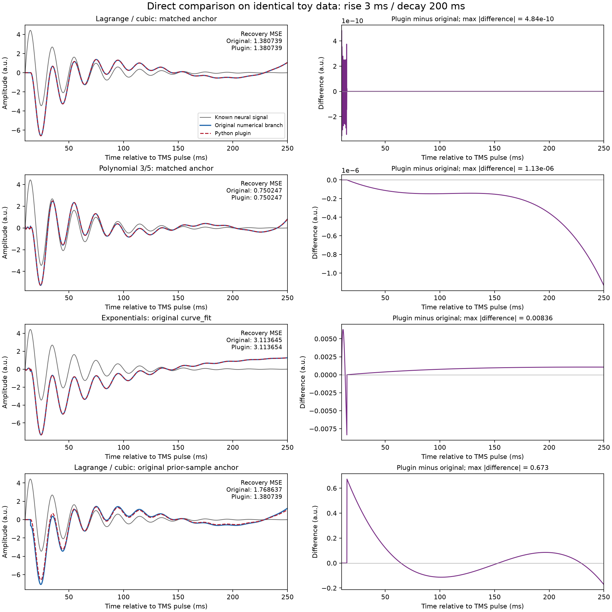

# Direct comparison: original paper branches and Python plugin

This report retains the **historical figure profile** via Config.figure_defaults(...)
and tmspath_config('figure'). The label default_lagrange3 refers to that recorded
profile. For current defaults and full TEP comparisons see [TEP_ALIGNMENT.md](TEP_ALIGNMENT.md).

This experiment executes numerical functions extracted unchanged from the original figure notebook and the Lagrange branch/polynomial helper from `computeDetrend_v6`. Controlled wrappers provide identical inputs and explicit fit settings. It does not run the entire preprocessing pipeline or claim equivalence to every historical script version. Source names, cell/line locations and SHA-256 hashes are in `PythonPlugin/paper_reference/manifest.json`.

## Shared inputs and evaluation

- 10 kHz; epoch -100 to 249.9 ms; onset 10 ms; supplied split 15 ms.
- Original damped oscillator: amplitude 5, frequency 50 Hz, damping 25/s. Original capacitive artifact scale -100.
- 100 noiseless grid cases: rise 1-50 ms and decay 25-250 ms (10 values each), plus 3/200 ms, 25/50 ms, and two 3/200 ms cases with Gaussian noise SD 0.5 and 2 (one realization each, seed 42).
- Every pair receives exactly the same array. Reference routines keep native milliseconds or seconds; the plugin receives seconds. Rise includes 10 ms and excludes 15 ms; decay includes 15 ms.
- All recovery MSE values use the same 2400 samples, 10.0-249.9 ms, and the clean oscillator as truth. Native figure captions sometimes use full-epoch scores or t>10 ms; those different masks are not mixed here.
- `metrics.csv` separately records recovery MSE, decay-only MSE, fit residual MSE, output-difference MSE, maximum absolute difference, failures and warnings. Delta MSE means plugin minus reference; negative favors plugin for that case.

## What is matched and what is deliberately different

| Comparison | Reference behavior | Plugin behavior |
|---|---|---|
| Lagrange/cubic, matched | Original high-degree np.polyfit rise; original constrained cubic helper; anchor aligned to observed 15 ms | Exact rise-node interpolation; scaled constrained cubic; same anchor |
| Polynomial 3/3 and 3/5, matched | Original np.polyfit rise and fit_constrained_poly decay; observed 15 ms anchor | Same degrees, no rise constraint, observed 15 ms decay anchor |
| Exponentials, original solver | Original curve_fit calls, p0 rise [5,10 ms], decay [100 ms], no bounds | Grid/refinement, positive taus 0.5-1000 ms, 21 initial values and 5 refinements; same functions and observed anchor |
| Exponentials, same bounds control | Same original functions and initial guesses, with 0.5-1000 ms bounds added explicitly | Same positive tau bounds; different optimizer |
| Lagrange/cubic, prior-sample anchor | Original pipeline decay anchor at last rise sample (14.9 ms with these fixed masks) | Observed split anchor at 15 ms |
| Polynomial 3/5, supplementary convention | Decay anchored to exponential-rise extrapolation at 15 ms | Observed split anchor |
| Polynomial 3/5, main-figure convention | Original cell 5 subtracts fitted rise peak before LS but adds observed peak after LS | Consistent observed anchor in subtraction and reconstruction |

The first three comparisons align boundary conventions to isolate numerical implementation. The convention comparisons intentionally preserve their original differences and must not be described as identical mathematical settings. The bounded exponential reference is an explicit control, not the unmodified paper solver.

The supplemental exponential sweep contains an inconsistent interpolation call using a local decay-time vector with the full signal. This benchmark uses the valid call from main-figure cell 5 with matching full time/signal vectors; it does not silently reproduce the sweep error or its penalty value.

## Extreme toy: 3/200 ms

| Comparison | Original recovery MSE | Plugin recovery MSE | Delta MSE | Max absolute output difference |
|---|---:|---:|---:|---:|
| Lagrange / cubic: matched anchor | 1.38073904 | 1.38073904 | 3.89244e-13 | 4.84127e-10 |
| Polynomial 3/3: matched anchor | 1.38083954 | 1.38083954 | 1.43663e-13 | 1.83303e-12 |
| Polynomial 3/5: matched anchor | 0.750247025 | 0.750247023 | -2.05371e-09 | 1.13191e-06 |
| Exponentials: original curve_fit | 3.11364498 | 3.11365368 | 8.69522e-06 | 0.00835657 |
| Exponentials: same tau bounds | 3.11364497 | 3.11365368 | 8.70879e-06 | 0.00835657 |
| Lagrange / cubic: original prior-sample anchor | 1.76863736 | 1.38073904 | -0.387898 | 0.672947 |
| Polynomial 3/5: supplementary anchor | 0.822345922 | 0.750247023 | -0.0720989 | 0.288714 |
| Polynomial 3/5: main-figure convention | 0.8371863 | 0.750247023 | -0.0869393 | 0.336476 |



## Across all 104 toy cases

| Comparison | Successful / failed | Median output-difference MSE | Worst absolute output difference | Warning cases |
|---|---:|---:|---:|---:|
| Lagrange / cubic: matched anchor | 104 / 0 | 3.7731e-27 | 6.06873 | 104 |
| Polynomial 3/3: matched anchor | 104 / 0 | 3.11906e-25 | 3.64224e-11 | 0 |
| Polynomial 3/5: matched anchor | 104 / 0 | 2.71085e-14 | 4.5296e-06 | 0 |
| Exponentials: original curve_fit | 104 / 0 | 2.14134e-06 | 1.06847 | 0 |
| Exponentials: same tau bounds | 104 / 0 | 1.17516e-06 | 0.0246676 | 0 |
| Lagrange / cubic: original prior-sample anchor | 104 / 0 | 0.00551634 | 6.06873 | 104 |
| Polynomial 3/5: supplementary anchor | 104 / 0 | 0.0122501 | 1.14009 | 0 |
| Polynomial 3/5: main-figure convention | 104 / 0 | 0.425487 | 1.32869 | 0 |

## Interpretation

Numerical agreement must be judged separately for matched settings and native conventions. Lagrange monomial fits may issue RankWarning and fail to interpolate high-frequency noise exactly, whereas the plugin zeroes the rise samples by construction. That behavior is not proof of early neural recovery. A lower recovery MSE in one case is not a universal ranking, and one noise realization per level is not a noise robustness study.

### Matched Lagrange/cubic: clean versus noisy input

| Input group | Original MSE | Plugin MSE | Maximum output difference |
|---|---:|---:|---:|
| extreme | 1.38073904 | 1.38073904 | 4.84127e-10 |
| extreme_noise05 | 1.69016442 | 1.68688718 | 1.14926 |
| extreme_noise2 | 4.80564679 | 4.7317438 | 6.06873 |

Across the 102 noiseless inputs, the largest Lagrange/cubic recovery-MSE difference is 1.412e-11 a.u.^2 and the maximum sample difference is 3.12496e-07 a.u. All original degree-49 Lagrange fits issue RankWarning, including those with close numerical agreement on smooth input.

### Exponential solver refinement control

The same-bounds reference isolates optimizer effects. The current default is 5 refinements; 3 is the previous default and 7 is an additional control. On the 3/200 ms toy, changing only plugin refinements gives:

| Plugin refinements | Recovery MSE | Output-difference MSE versus same-bounds curve_fit |
|---|---:|---:|
| 3 | 3.12369609 | 0.0105418 |
| 5 | 3.11365368 | 1.14749e-06 |
| 7 | 3.11365097 | 6.98763e-07 |

This control does not change the shipped defaults. It shows that much of the default exponential discrepancy in this example is due to finite search resolution, rather than a different rise/decay model.

## Reproduce

From `scripts/PythonPlugin`, in the documented Python environment:
```bash
python compare_paper_plugin.py
```

Outputs are written to `scripts/results/paper_plugin_comparison`. The script imports the local plugin directly. It preserves all input/output arrays, source provenance, dependency versions, fit diagnostics and warnings. No changes to the plugin algorithm were made for this comparison.

Reference source extracts retain their original comments for auditability. New wrapper code and reporting are in English.
