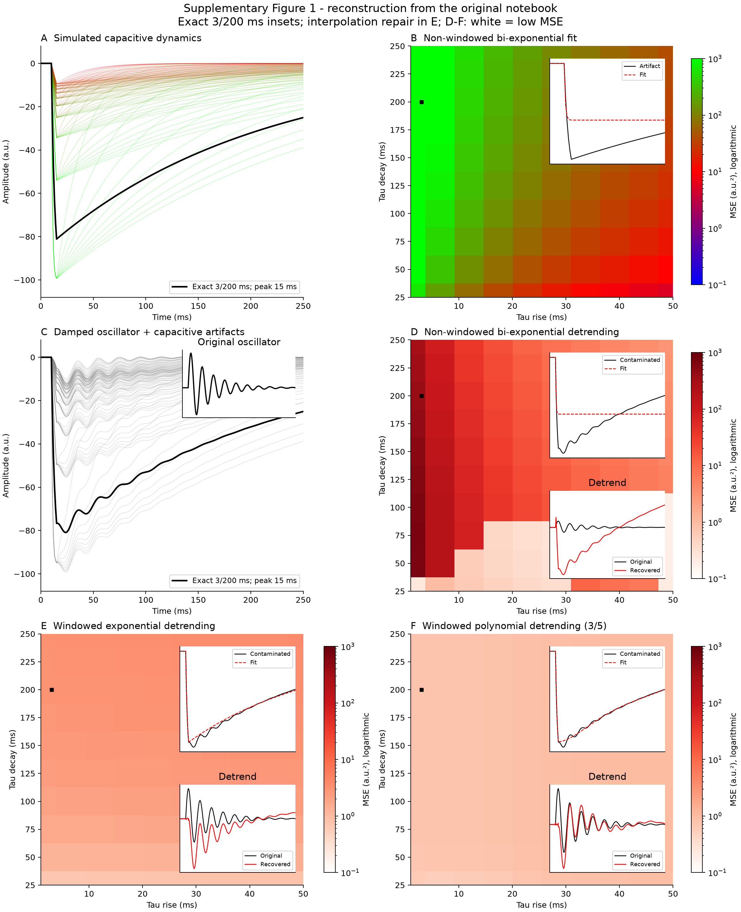
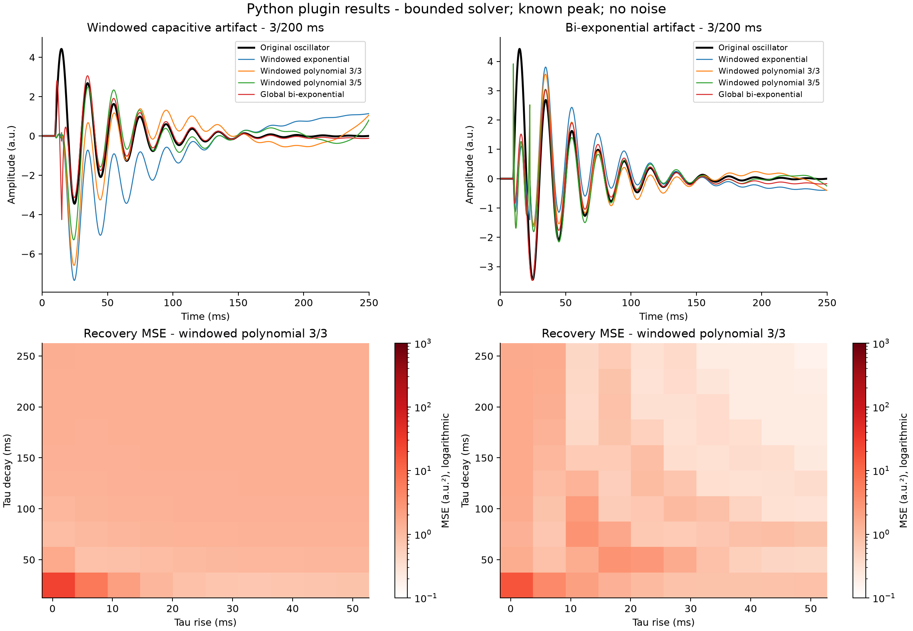
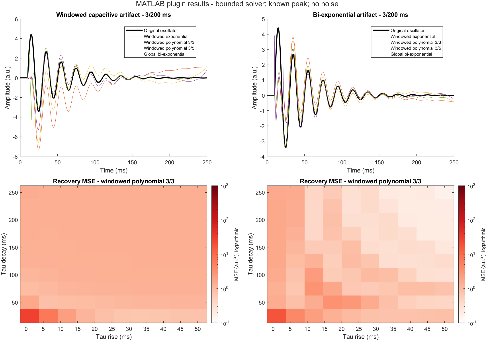

# Windowed detrending: Python and MATLAB plugins

Both standalone plugins accept epoched signals and expose configurable rise/decay detrending. They are local development packages; no PyPI or MATLAB File Exchange publication has been performed.

- [Post-epoching usage guide and copy/paste toy examples](POST_EPOCHING_GUIDE.md)
- [Python plugin](PythonPlugin/README.md)
- [MATLAB plugin](MatlabPlugin/README.md)
- [Interactive A-F dashboard](results/supplement1/dashboard.html)
- [Method alignment and solver differences](PAPER_ALIGNMENT.md)

## Supplementary Figure 1 reconstructed in Python



[Vector PDF](images/supplementary_figure_1_python.pdf)

A: isolated capacitive artifacts. B: non-windowed bi-exponential artifact fit. C: artifacts plus damped oscillator. D-F: oscillator recovery with non-windowed bi-exponential, windowed exponential, and windowed polynomial detrending. All MSE maps use a common logarithmic range of 0.1-1000 a.u.². D-F use white for the lowest value and dark red for the highest. Insets use the exact 3/200 ms case, with peak at 15 ms.

This reconstruction uses the original SciPy notebook fitting conventions, not the bounded plugin solver. It explicitly repairs the mismatched interpolation-vector lengths in panel E. Unlike the notebook's nearest-grid-point selection, insets use the exact 3/200 ms parameters. D-F insets use the same algorithms as their maps. Panel F uses degrees 3/5, including the sweep's decay boundary estimated from the exponential rise fit. B retains the notebook's different fit settings between its map (free onset) and inset (fixed onset). B/D MSE is evaluated for t > 10 ms; E/F MSE is evaluated over the full epoch.

Numerical source: [data and method notes](results/supplement1/data.json), [404 fit metrics](results/supplement1/metrics.csv), [reproduction script](results/supplement1/replicate_supplement1.py).

## Python plugin results

The benchmark figures below are historical outputs generated before the
exponential-search default changed from 3 to 5 refinements. They have not
been relabeled as current-default results. For the recomputed current
comparison, see [PAPER_PLUGIN_COMPARISON.md](PAPER_PLUGIN_COMPARISON.md) and
the Python notebook / MATLAB Live Script linked in the usage guide.



[Vector PDF](images/plugin_results_python.pdf)

## MATLAB plugin results



[Vector PDF](images/plugin_results_matlab.pdf)

The plugin figures use their own bounded fits and the same shared fixture: two artifact families, four methods, a known peak, and noiseless 3/200 ms recovery examples. The lower maps show polynomial 3/3 recovery MSE over 10-249.9 ms. The MATLAB figure is exported by MATLAB from its actual recovered signals, not from Python's recovered signals. These plugin figures should not be interpreted as exact numerical reproductions of the original unconstrained notebook solver.

Across the full shared benchmark (214 cases, 856 outputs), the maximum Python-MATLAB absolute difference is 1.70 × 10⁻¹² a.u. For the 202 isolated artifacts, the maximum difference is 1.99 × 10⁻¹³ a.u. Reports are in [results/matlab](results/matlab).

## Reproduce the figures

From this `scripts` directory, with NumPy, SciPy and Matplotlib installed:

```bash
python export_results_figures.py
```

In MATLAB, with `scripts` as the current folder:

```matlab
export_results_matlab(pwd)
```

These commands render the saved numerical results to `images` as PNG and PDF. To rerun the plugin benchmarks, follow each plugin's README; shared fixtures and validation results are included under `results`. The supplementary reproduction script writes new results into its own `regenerated` subfolder.


## Default-model update

The plugin default is now Lagrange rise interpolation with cubic decay. The historical benchmark figures above retain their explicitly specified models and results. Updated default-model examples and figures are in [the post-epoching guide](POST_EPOCHING_GUIDE.md). Lagrange interpolation subtracts the complete observed rise segment, leaving zero residual there.
