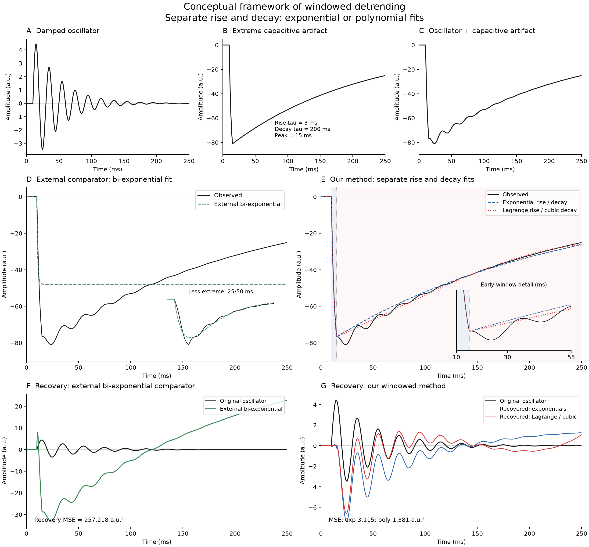
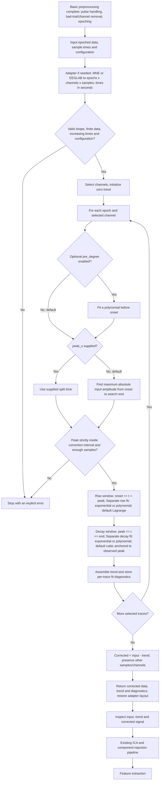
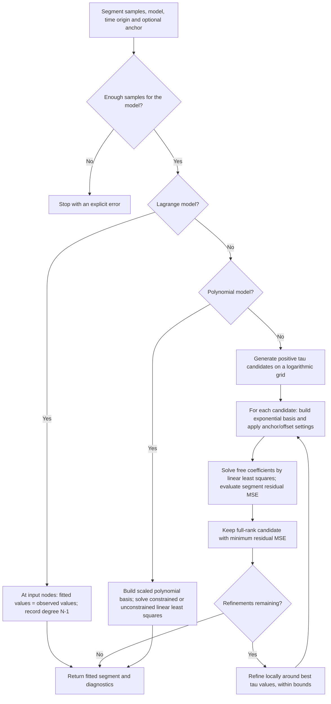
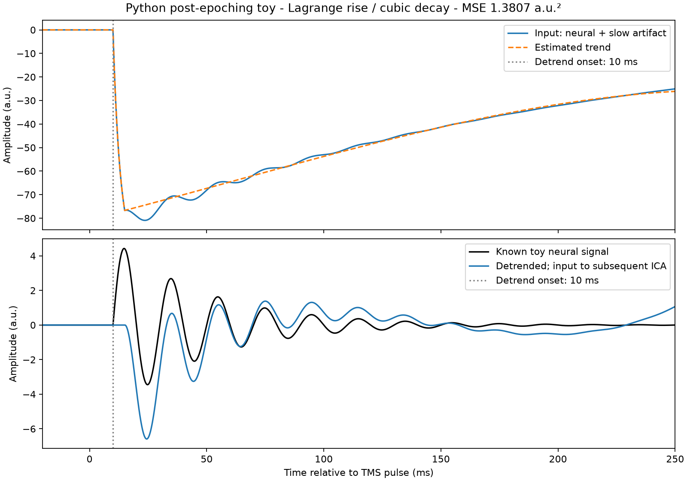
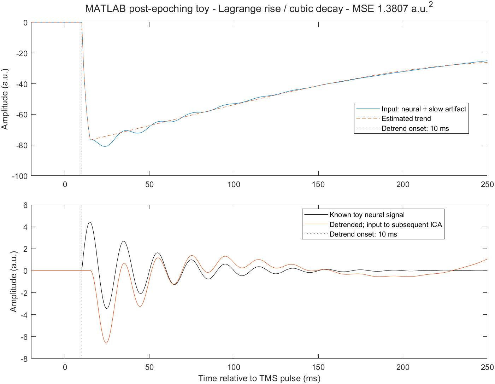

# Using the detrending plugins after basic preprocessing

## Where the plugin belongs

```text
Pulse-artifact handling / interpolation
    → bad-trial and bad-channel removal
    → epoching (retain times relative to the TMS pulse)
    → WINDOWED DETREND  ← these plugins
    → your subsequent ICA / component rejection
    → feature extraction
```

The input is already preprocessed and epoched. The plugin estimates and subtracts the remaining slow trend independently for each selected channel and epoch. It does not remove the stimulation pulse, detect bad trials/channels, epoch the recording, run ICA, or extract features. Continue those steps in your existing pipeline using the corrected output. Fit subsequent ICA on the detrended data rather than reusing a decomposition fitted before this transformation.

Both implementations preserve amplitude units and array dimensions. Python/MNE data remain in their input units (normally volts); EEGLAB data remain in their input units (often microvolts). The toy below uses arbitrary units. **All core configuration times are in seconds relative to the TMS event**, including when an epoch starts before zero. The EEGLAB adapter converts `EEG.times` from milliseconds automatically.

## Scientific rationale: capacitive rise and decay

After pulse-artifact handling and basic preprocessing, the remaining large, slow TMS-evoked artifact is treated here as a **capacitive charging/discharging transient**, with a rise phase followed by a decay phase. This is the working model for the targeted artifact, not a claim that every residual TMS-EEG artifact is capacitive. The rise/decay terminology describes the artifact's magnitude; its recorded polarity can be negative or positive.

**Our algorithm directly separates rise and decay at the artifact peak.** It fits the two windows independently, using either exponential functions or polynomial functions, assembles the estimated trend and subtracts it from the observed signal. The polynomial default is Lagrange rise interpolation with degree-3 decay.

The **non-windowed bi-exponential is an external comparator**, not a component or intermediate step of our algorithm. It describes the entire interval with one function, `f(t) = A * (1 - exp(-u/tau_rise)) * exp(-u/tau_decay)`, where `u = max(t - t_on, 0)`. Its coupled rise/decay parameters provide a reference against which the windowed approach can be evaluated.

The simulated capacitive waveform in Supplementary Figure 1 is constructed with an explicit transition between charging and discharging. A single multiplicative bi-exponential is therefore an alternative approximation to that waveform, not an algebraically identical expression. Its difficulty can reflect model mismatch as well as parameter-estimation behavior.

### Conceptual framework



[Vector PDF](images/paper_concept_computed.pdf) | [Editable SVG](images/paper_concept_computed.svg) | [Python source](reconstruct_paper_concept.py)

A-C show the simulated oscillator, capacitive artifact and their sum. **E and G illustrate our algorithm:** split at the peak, fit rise and decay separately with exponentials or polynomials, subtract the assembled trend and assess the corrected signal. **D and F show an external bi-exponential comparator only.** The bi-exponential is not part of the windowed processing path.

All curves are numerically computed at 0.1 ms resolution. The artifact has rise/decay constants 3/200 ms, onset 10 ms and peak 15 ms; the windowed fits use this known split. Recovery MSE is evaluated over the same 10.1-249.9 ms interval: 3.115 a.u.^2 for windowed exponentials and 1.381 a.u.^2 for Lagrange rise / cubic decay. The displayed external comparator has MSE 257.218 a.u.^2.

The external comparator shown uses a single-initialization unconstrained fit and returns a negative decay time constant. Its poor result characterizes that specific fitting configuration, not all possible bi-exponential implementations. This conceptual example explains the method and does not establish universal superiority over external methods. Lagrange interpolation removes the complete rise-window signal, including any neural component. Current figure data and diagnostics are in `results/paper_concept`; the previously computed additional global comparison is retained separately in `results/comparator_archive` for traceability and is not displayed in this framework.

### Why consider polynomials for extreme artifacts?

For the extreme capacitive-artifact conditions investigated in the paper, windowed polynomial detrending is motivated by the limited ability of a single global bi-exponential fit to accommodate a very rapid rise together with a prolonged decay. Windowed exponentials separate these phases but still impose an exponential shape within each window. Polynomials provide a more flexible local approximation without requiring that exact exponential shape.

**The methodological thesis is that separating the rise and decay, and using suitable polynomial fits within those windows, can improve removal of extreme capacitive artifacts and recovery of the underlying signal under the investigated conditions.** This is a conditional, experimentally evaluated claim, not a theorem that polynomials always outperform exponential models. The fitted polynomial is a detrending approximation; it is not itself a physical capacitor model.

### What the comparisons establish

A direct same-input audit is available in [PAPER_PLUGIN_COMPARISON.md](PAPER_PLUGIN_COMPARISON.md).
It compares the original numerical branches and the Python plugin with
matched settings, then separately quantifies original boundary conventions,
noise effects and exponential solver differences. Run
`python compare_paper_plugin.py` from `scripts/PythonPlugin` to reproduce it.

The two evaluation questions must remain distinct:

- **Artifact fitting:** how closely does the estimated trend approximate an isolated synthetic artifact? This is the MSE in panel B.
- **Neural recovery:** after subtracting the fitted trend from artifact plus oscillator, how closely does the corrected signal match the known original oscillator? This is the MSE in panels D-F.

A small fitting residual against the contaminated input does not establish good neural recovery. A flexible fit may absorb genuine neural activity. Comparisons therefore depend on the artifact family, rise/decay constants, fit interval, polynomial degree, constraints, initialization, solver and evaluation window.

Fitting procedures and initialization affect external comparator performance. Comparisons should specify those choices and must not present one illustrative outcome as a universal ranking. Implementation details and supplementary-figure adjustments are documented in [PAPER_ALIGNMENT.md](PAPER_ALIGNMENT.md).

### How this relates to the current default

The current default follows the windowed polynomial strategy: **Lagrange interpolation in the rise window and a degree-3 polynomial in the decay window**. Separate exponential rise/decay fits are the alternative within our algorithm. Global bi-exponential fitting is available only as an external comparison utility. The historical supplementary panels and the 3/3 and 3/5 benchmark configurations are not identical to this new default.

With Lagrange interpolation through every rise sample, the estimated trend equals the observed input at those samples. Subtraction therefore leaves zero in the rise window, removing any neural activity there as well. This behavior must not be described as recovery of the early neural response. The cubic decay and the complete corrected epoch should be evaluated separately, using the known clean signal in simulations and appropriate quality checks in real recordings.


## Actual defaults and associated functions

The current defaults are **windowed polynomial detrending: Lagrange rise and cubic decay, with an automatically detected peak**. The examples below use these default models and explicitly fix the toy peak at 15 ms. The default peak on real data remains automatic.

Create the default configuration in Python:

```python
from windowed_detrend import Config, detrend
cfg = Config()
corrected, trend, diagnostics = detrend(data, times, cfg)
```

Create the equivalent configuration in MATLAB:

```matlab
cfg = tmspath_config();
[corrected, trend, diagnostics] = tmspath_detrend(data, times, cfg);
```

Here `data` is the existing epoched array `[epochs, channels, samples]`, and `times` contains seconds relative to TMS. For dataset objects, use `detrend_mne(epochs, cfg)` in Python or `tmspath_eeglab(EEG, cfg)` in MATLAB, as detailed below.

### Default parameter table

| Parameter | Python default | MATLAB default | Effect / associated operation |
|---|---|---|---|
| `mode` | `'windowed'` | `'windowed'` | `detrend` / `tmspath_detrend`: separate rise and decay fits |
| `onset_s` | `0.010` | `0.010` | Correction starts at 10 ms after TMS |
| `peak_s` | `None` | `[]` | Detect a peak independently for each epoch and selected channel |
| `peak_search_end_s` | `0.100` | `0.100` | Search from onset to the smaller of 100 ms and correction end |
| `end_s` | `None` | `[]` | Correction ends at the last sample of the epoch |
| `rise_model` | `'lagrange'` | `'lagrange'` | Interpolate all rise samples with degree N-1 |
| `decay_model` | `'poly'` | `'poly'` | Polynomial decay, degree 3 |
| `global_model` | `'biexp'` | `'biexp'` | External-comparator utility only (`mode='global'`); not used by the windowed algorithm |
| `rise_degree` | `3` | `3` | Inactive for Lagrange (degree N-1); used only when the rise model is `'poly'` |
| `decay_degree` | `3` | `3` | Polynomial degree, used only when the selected decay/global model is `'poly'` |
| `pre_degree` | `None` | `[]` | No pre-onset polynomial fit; pre-onset samples stay unchanged |
| `constrain_rise` | `False` | `false` | Lagrange interpolates the observed nodes; no separate zero-onset constraint |
| `constrain_decay` | `True` | `true` | Anchor decay to the observed signal value at the split, obtained by interpolation |
| `fit_offset` | `False` | `false` | Do not add a constant offset to exponential model bases |
| `tau_min_s` | `0.0005` | `0.0005` | Lower bound for fitted time constants: 0.5 ms |
| `tau_max_s` | `1.0` | `1.0` | Upper bound for fitted time constants: 1000 ms |
| `grid_size` | `21` | `21` | Initial logarithmic search: 21 candidate values per time constant |
| `refinements` | `5` | `5` | Five local search refinements, with 7 values per time constant at each level |
| `channels` | `None` | `[]` | Core functions process all input channels by default |

The MNE adapter overrides the core channel selection by default: it selects EEG channels and excludes channels marked bad. The EEGLAB adapter uses `cfg.channels` as supplied; an empty list means all input channels. Python indices are zero-based; MATLAB indices are one-based.

Automatic peak selection uses the maximum **absolute input amplitude**, not a fitted peak, a derivative, or the known neural signal. The peak must lie strictly between onset and correction end. Lagrange needs at least two distinct samples. Each exponential segment needs at least four samples; a polynomial segment needs at least `max(4, degree + 2)`. Invalid windows produce an error, not an automatic fallback.

### Default model functions

Let `x(t)` be one input epoch/channel, `t_on` the onset, `t_peak` the split, and `t_end` the correction end. All times and fitted time constants are in seconds.

| Window | Default function | Estimated / constrained parameters |
|---|---|---|
| Rise: `t_on <= t < t_peak` | `P(t) = sum_i x_i * L_i(t)`, where `L_i(t) = product_{j != i} (t-t_j)/(t_i-t_j)` | Degree N-1 for N rise samples; `P(t_i)=x_i` |
| Decay: `t_peak <= t <= t_end` | `P_decay(t) = V_peak + a1*u + a2*u^2 + a3*u^3`, with `u=(t-t_peak)/scale` | `V_peak = interp(x,t_peak)`; estimate a1, a2, a3 by least squares |
| Outside the correction interval | `trend(t) = 0` | Input stays unchanged with default `pre_degree` |
| Corrected output | `corrected(t) = x(t) - trend(t)` | Subtract the assembled trend |

**Lagrange interpolation reproduces every input sample in the rise window. Consequently, the corrected rise samples are zero, including any neural activity or noise in that window.** This is not evidence of recovery of the early neural response. The implementation uses the exact node identity instead of constructing unstable high-degree monomial coefficients. Diagnostics retain the node times/values and degree N-1. This matches the intended interpolation in the original `wind_poly_lagrange` branch; numerical differences from its high-degree `np.polyfit` can occur because that computation can be ill-conditioned.

The decay anchor is the observed signal at the split, not an extrapolation of the rise interpolant. `rise_degree=3` remains available for an explicitly selected `rise_model='poly'`; it does not constrain the Lagrange degree. Tau search settings and `fit_offset` are inactive for the default Lagrange/cubic models and apply to optional exponential fits.

### Implementation functions

| Operation | Python | MATLAB |
|---|---|---|
| Configuration | `Config()` in [core.py](PythonPlugin/src/windowed_detrend/core.py) | [tmspath_config.m](MatlabPlugin/tmspath_config.m) |
| Array entry point and window selection | `detrend(data, times, cfg)` in [core.py](PythonPlugin/src/windowed_detrend/core.py) | [tmspath_detrend.m](MatlabPlugin/tmspath_detrend.m) |
| Dataset adapter | `detrend_mne(epochs, cfg, picks=...)` | [tmspath_eeglab.m](MatlabPlugin/tmspath_eeglab.m) |
| Segment fitting | Internal `fit_segment(...)` | Local `fit_segment(...)` inside `tmspath_detrend.m` |
| Model basis evaluation | Internal `_basis(...)` | Local `basis(...)` inside `tmspath_detrend.m` |
| Synthetic signal generation | `synthetic(...)` in [benchmark.py](PythonPlugin/src/windowed_detrend/benchmark.py) | [tmspath_synthetic.m](MatlabPlugin/tmspath_synthetic.m) |

The default rise uses exact interpolation at the observed nodes; the cubic decay uses constrained linear least squares. Optional exponential models use a bounded logarithmic search for time constants with linear least squares for the free coefficients (variable projection). It does not call the original notebook's unconstrained `curve_fit`. The core needs NumPy in Python and base MATLAB in MATLAB; dataset adapters use the corresponding analysis environment.

The exponential-search default is now **5 refinements** in both languages
(previously 3), with 21 initial grid points. This improves tau resolution at
some additional computational cost. Lagrange/cubic results are unaffected.
The notebook, Live Script and direct paper comparison use the updated default.

## Algorithm flowchart

The flowchart describes our windowed algorithm, including its exponential and polynomial alternatives. External bi-exponential comparators are deliberately outside this processing path.



### Segment-fitting subroutine



For least-squares fits, the optimization objective is the segment residual MSE against the observed input. Lagrange interpolates the input nodes exactly and has zero residual at those nodes. It is different from the toy recovery MSE against a known clean oscillator.


## Choose and inspect the correction interval

The examples use an onset of 10 ms, a split at 15 ms, and Lagrange interpolation in the rise window and polynomial degree 3 in the decay window to match a toy with a known peak. The times are demonstration values, not universal TMS-EEG settings; the model choices now match the plugin defaults. Choose the fit start after your pulse-handling interval, and set the split/end from the residual artifact and your sampling resolution. The plugin requires at least `max(4, degree + 2)` samples in each polynomial window: degree 3 requires five samples. The default Lagrange rise needs at least two distinct samples. A five-millisecond rise interval can be too short at some sampling rates; do not upsample simply to manufacture independent fitting information.

With `pre_degree=None` in Python or `[]` in MATLAB, the plugin does not fit the pre-onset samples. Samples outside the chosen correction interval remain unchanged. This is not a baseline-correction step. Review input, trend and output before ICA: a good artifact fit does not prove preservation of the early neural response. Real recordings have no known clean waveform, so the toy's recovery MSE is unavailable for real data.

## Python: setup

The examples use the generic repository location `C:\path\to\windowedDetrend`. Replace it with the folder where you downloaded the repository. No personal or institution-specific directory is required.

Create an environment for the dependencies, then import the plugin directly from its source folder. Installing the plugin itself or publishing it on PyPI is not required. If your existing analysis environment already provides these dependencies, you can keep using it and proceed to the source-path setup below.

### Create the environment with Conda or Miniforge

Run in a terminal where `conda` is available:

```powershell
Set-Location "C:\path\to\windowedDetrend\scripts\PythonPlugin"
conda env create -f environment.yml
conda activate windowed-detrend
```

The [environment.yml](PythonPlugin/environment.yml) file provides Python 3.12, NumPy for the core algorithm, and SciPy and Matplotlib for simulations and figures. MNE is optional. For the MNE example below, also run:

```bash
conda install -c conda-forge "mne>=1.6"
```

Select the `windowed-detrend` interpreter in your editor or notebook environment. When working with an existing MNE pipeline, run it in the same environment as the plugin so the existing `epochs` object remains available.

### Alternative: standard Python with venv

With Python 3.10 or newer, run from `scripts/PythonPlugin` in PowerShell:

```powershell
python -m venv .venv
.\.venv\Scripts\python.exe -m pip install -r requirements.txt
# Optional, only for the MNE adapter:
.\.venv\Scripts\python.exe -m pip install "mne>=1.6"
```

These commands install dependencies only. Select `PythonPlugin/.venv/Scripts/python.exe` as your analysis interpreter. Using its explicit path avoids requiring shell activation. The dependency files specify version ranges, not a fully locked environment; see [ENVIRONMENT.md](PythonPlugin/ENVIRONMENT.md) for recording resolved versions.

### Make the source available to your pipeline

Run this block once per Python session, before any `windowed_detrend` imports. Change the path if you move the repository:

```python
import sys
from pathlib import Path

scripts_dir = Path(
    r"C:\path\to\windowedDetrend\scripts"
)
plugin_src = scripts_dir / "PythonPlugin" / "src"
if not (plugin_src / "windowed_detrend" / "__init__.py").is_file():
    raise FileNotFoundError(f"Plugin source not found: {plugin_src}")
sys.path.insert(0, str(plugin_src))

from windowed_detrend import Config, detrend
```

The configuration class is `Config`. This source-path setup is the Python equivalent of adding the MATLAB plugin folder with `addpath`. The following MNE and NumPy examples assume it has been run in the same session.

### Interactive Python notebook

All editable parameters are at the beginning: **A. Toy signal parameters**
defines the synthetic input; **B. Detrending parameters** lists all core
settings, optional comparison overrides, and evaluation/display controls.
English comments and an options table explain alternatives and inactive
settings. Edit these cells, then restart the kernel and run all cells.
Generating time constants are distinct from fitted-tau search bounds.

The [demo notebook](PythonPlugin/demo_windowed_detrend.ipynb) contains a complete
toy demonstration: source import, synthetic signal, `detrend` function call,
recovery MSE, plots and optional separate exponential fits. Saved outputs are
included; run all cells in order to recompute the results.

The Conda `environment.yml` also includes JupyterLab and ipykernel. If the
environment was created earlier, update it before launching:

```powershell
Set-Location "C:\path\to\windowedDetrend\scripts\PythonPlugin"
conda env update -n windowed-detrend -f environment.yml
conda activate windowed-detrend
python -m jupyterlab demo_windowed_detrend.ipynb
```

With the venv alternative, from the same directory:

```powershell
.\.venv\Scripts\python.exe -m pip install -r requirements-notebook.txt
.\.venv\Scripts\python.exe -m jupyterlab demo_windowed_detrend.ipynb
```

Select the matching Python environment as the kernel. The notebook locates
the local source automatically and does not require installation of the plugin.

### Insert into an existing MNE pipeline

The variable `epochs` below is your **existing**, already-preprocessed `mne.Epochs` object. This block does not reload raw data or repeat preprocessing.

```python
import numpy as np
import mne
from windowed_detrend import Config, detrend_mne

epochs.load_data()
picks = mne.pick_types(epochs.info, eeg=True, exclude='bads')
assert len(picks) > 0, 'No usable EEG channels selected'

cfg = Config(
    onset_s=0.010,              # adapt to your pulse-handling interval
    peak_s=0.015,               # adapt to the observed residual-artifact peak
    end_s=float(epochs.times[-1]),
    rise_model='lagrange', decay_model='poly',
    rise_degree=3, decay_degree=3,
    constrain_rise=False, constrain_decay=True,
    pre_degree=None,
)
epochs_detrended, trend, diagnostics = detrend_mne(epochs, cfg, picks=picks)
assert epochs_detrended.get_data().shape == epochs.get_data().shape

# Quality control before continuing: inspect individual trials/channels.
epochs_detrended.plot(picks=picks[:min(5, len(picks))])

# Continue YOUR ICA/component-rejection and feature pipeline with this object.
epochs_for_ica = epochs_detrended
# Example handoff: your existing ICA fit should receive epochs_for_ica.
# Feature extraction should receive the output AFTER your ICA cleaning.
```

`epochs` is preserved; the adapter returns a corrected copy. By default it selects EEG channels and excludes channels marked bad. The explicit `picks` above makes that choice visible. Trend has the same `[epochs, channels, samples]` layout as the MNE data; unselected channels have zero estimated trend.

### If you use NumPy instead of MNE

```python
from windowed_detrend import Config, detrend

# data: existing float array [n_epochs, n_channels, n_samples]
# times: existing 1D sample-time vector, seconds relative to TMS
cfg = Config(onset_s=0.010, peak_s=0.015, end_s=float(times[-1]),
             rise_model='lagrange', decay_model='poly',
             rise_degree=3, decay_degree=3, constrain_rise=False,
             constrain_decay=True, pre_degree=None)
# Optional: cfg.channels = (0, 1, 2)  # Python channel indices are zero-based
corrected, trend, diagnostics = detrend(data, times, cfg)
data_for_ica = corrected
```

## MATLAB: setup and insertion into EEGLAB

Open MATLAB and run this setup once per session:

```matlab
scriptsDir = "C:\path\to\windowedDetrend\scripts";
cd(scriptsDir);
addpath(fullfile(scriptsDir, 'MatlabPlugin'));
```

The variable `EEG` below is your **existing**, already-preprocessed and epoched EEGLAB dataset. The adapter expects numeric, loaded data in `[channels, samples, trials]` order and `EEG.times` in milliseconds. For a single trial, verify from your pipeline that the input is an epoch rather than a continuous recording.

```matlab
assert(isnumeric(EEG.data), 'Load the epoched EEG data into memory first');
assert(isempty(EEG.icaweights), 'Insert detrending before fitting ICA');

cfg = tmspath_config();
cfg.onset_s = 0.010;            % adapt to your pulse-handling interval
cfg.peak_s = 0.015;             % adapt to the residual-artifact peak
cfg.end_s = double(EEG.times(end)) / 1000;
cfg.rise_model = 'lagrange'; cfg.decay_model = 'poly';
cfg.rise_degree = 3; cfg.decay_degree = 3;
cfg.constrain_rise = false; cfg.constrain_decay = true;
cfg.pre_degree = [];

% This assumes ALL remaining channels are EEG channels.
% If EOG/ECG/other channels remain, replace this list with EEG-only indices.
cfg.channels = 1:EEG.nbchan;    % MATLAB channel indices are one-based
[EEG_detrended, trend, diagnostics] = tmspath_eeglab(EEG, cfg);
EEG_detrended = eeg_checkset(EEG_detrended);
assert(isequal(size(EEG_detrended.data), size(EEG.data)));

% Inspect one retained channel/trial before continuing.
channel = cfg.channels(1); trial = 1;
figure;
plot(EEG.times, squeeze(EEG.data(channel,:,trial))); hold on;
plot(EEG.times, squeeze(EEG_detrended.data(channel,:,trial)));
xlabel('Time relative to TMS pulse (ms)'); ylabel('Input amplitude units');
legend('Before detrend', 'After detrend');

% Continue YOUR ICA/component-rejection pipeline with the corrected dataset.
EEG_for_ica = EEG_detrended;
% Feature extraction follows the ICA-cleaned output of your existing pipeline.
```

The original `EEG` variable is preserved. The returned `trend` follows EEGLAB's `[channels, samples, trials]` layout. The plugin itself needs no EEGLAB or Optimization Toolbox; the adapter example uses EEGLAB's dataset and `eeg_checkset` from your existing environment.

### Interactive MATLAB Live Script

The opening sections **A. Toy signal parameters** and **B. Detrending
parameters** contain all editable settings, including optional comparison
and evaluation controls. English comments explain meanings, alternatives
and model/constraint compatibility. Edit these sections and select Run All.
No configuration values are overwritten in the processing sections.

Open [demo_windowed_detrend.mlx](MatlabPlugin/demo_windowed_detrend.mlx) and
select **Run All** to recompute the toy, fits, recovery metrics and figures:

```matlab
open("C:\path\to\windowedDetrend\scripts\MatlabPlugin\demo_windowed_detrend.mlx");
```

The Live Script adds its own folder to the MATLAB path, uses base MATLAB,
and requires no plugin installation. It demonstrates Lagrange rise / cubic
decay and the alternative separate exponential fits. The known toy split is
15 ms; ordinary default peak selection remains automatic. A plain-text
companion, `MatlabPlugin/demo_windowed_detrend_source.m`, is also provided.

### If you use MATLAB arrays instead of EEGLAB

```matlab
% data: existing numeric array [n_epochs, n_channels, n_samples]
% times: existing vector in SECONDS relative to TMS
cfg = tmspath_config();
cfg.onset_s = 0.010; cfg.peak_s = 0.015; cfg.end_s = times(end);
cfg.rise_model = 'lagrange'; cfg.decay_model = 'poly';
cfg.rise_degree = 3; cfg.decay_degree = 3;
cfg.constrain_rise = false; cfg.constrain_decay = true; cfg.pre_degree = [];
[corrected, trend, diagnostics] = tmspath_detrend(data, times, cfg);
data_for_ica = corrected;
```

## Same toy signal in both environments

The toy has one epoch and one channel, a 100 ms prestimulus interval, a 50 Hz damped oscillator and a slow capacitive artifact with rise/decay constants 3/200 ms. It contains no pulse artifact, noise, bad channels or bad trials: those preprocessing steps are assumed complete. The 10 kHz sample rate provides enough samples in the short rise window. The demo stops at the ICA handoff; meaningful multichannel ICA is not demonstrated on a one-channel toy.

With the Conda environment activated, run `python toy_post_epoching.py` from `scripts`. With the venv alternative, run `.\PythonPlugin\.venv\Scripts\python.exe toy_post_epoching.py` from `scripts`. The Python toy adds the local source folder itself, so no plugin installation is needed. In MATLAB, run `toy_post_epoching` from the same folder. Both examples save their figures in `images` and numerical output in `results/toy`. Full copy-and-paste versions follow.

### Python toy

```python
"""Run from the repository's scripts directory with dependencies available."""
from pathlib import Path
import sys
import json
import numpy as np
import matplotlib.pyplot as plt

plugin_src = Path.cwd() / "PythonPlugin" / "src"
if not (plugin_src / "windowed_detrend" / "__init__.py").is_file():
    raise FileNotFoundError("Run this example from the repository's scripts directory")
sys.path.insert(0, str(plugin_src))
from windowed_detrend import Config, detrend

# Toy data represent an already-epoched signal; pulse artifact is absent.
fs = 10000
times = np.arange(-1000, 2500) / fs  # seconds relative to the TMS pulse at zero
u = np.maximum(times - 0.010, 0)
neural = 5 * np.exp(-25 * u) * np.sin(2 * np.pi * 50 * u)
artifact = -100 * (1 - np.exp(-u / 0.003))
decay = times >= 0.015
artifact[decay] = -100 * (1 - np.exp(-0.005 / 0.003)) * np.exp(-(times[decay] - 0.015) / 0.200)
data = (neural + artifact)[None, None, :]  # epochs x channels x samples

cfg = Config(onset_s=0.010, peak_s=0.015, end_s=times[-1],
             rise_model='lagrange', decay_model='poly', rise_degree=3,
             decay_degree=3, constrain_rise=False, constrain_decay=True,
             pre_degree=None)
corrected, trend, diagnostics = detrend(data, times, cfg)
mask = times >= cfg.onset_s
mse = float(np.mean((corrected[0, 0, mask] - neural[mask])**2))
assert corrected.shape == data.shape
np.testing.assert_array_equal(corrected[..., ~mask], data[..., ~mask])
print(f'Toy recovery MSE: {mse:.6f} a.u.^2')

out = Path.cwd() / 'images'
out.mkdir(exist_ok=True)
fig, axes = plt.subplots(2, 1, figsize=(10, 7), sharex=True, layout='constrained')
axes[0].plot(times * 1000, data[0, 0], label='Input: neural + slow artifact')
axes[0].plot(times * 1000, trend[0, 0], '--', label='Estimated trend')
axes[1].plot(times * 1000, neural, 'k', label='Known toy neural signal')
axes[1].plot(times * 1000, corrected[0, 0], label='Detrended; input to subsequent ICA')
for ax in axes:
    ax.axvline(10, color='.5', ls=':', label='Detrend onset: 10 ms')
    ax.set_ylabel('Amplitude (a.u.)')
    ax.legend(loc='best')
axes[1].set_xlabel('Time relative to TMS pulse (ms)')
axes[1].set_xlim(-20, 250)
fig.suptitle(f'Python post-epoching toy - Lagrange rise / cubic decay - MSE {mse:.4f} a.u.²')
fig.savefig(out / 'toy_post_epoching_python.png', dpi=160)
plt.close(fig)
results = Path.cwd() / 'results' / 'toy'
results.mkdir(parents=True, exist_ok=True)
np.savez(results / 'python_toy.npz', times=times, data=data, truth=neural,
         corrected=corrected, trend=trend)
(results / 'python_summary.json').write_text(json.dumps({'mse': mse, 'shape': list(data.shape)}))
# In real data, pass corrected (or the MNE/EEGLAB adapter output) to ICA next.
```



### MATLAB toy

```matlab
% Run this script with the repository's scripts directory as current folder.
addpath(fullfile(pwd, 'MatlabPlugin'));
fs = 10000;
times = (-1000:2499)' / fs;  % seconds relative to the TMS pulse at zero
u = max(times - 0.010, 0);
neural = 5 * exp(-25 * u) .* sin(2*pi*50*u);
artifact = -100 * (1 - exp(-u / 0.003));
decay = times >= 0.015;
artifact(decay) = -100 * (1-exp(-0.005/0.003)) * exp(-(times(decay)-0.015)/0.200);
data = reshape(neural + artifact, 1, 1, []);  % epochs x channels x samples

cfg = tmspath_config();
cfg.onset_s = 0.010; cfg.peak_s = 0.015; cfg.end_s = times(end);
cfg.rise_model = 'lagrange'; cfg.decay_model = 'poly';
cfg.rise_degree = 3; cfg.decay_degree = 3;
cfg.constrain_rise = false; cfg.constrain_decay = true; cfg.pre_degree = [];
[corrected, trend, diagnostics] = tmspath_detrend(data, times, cfg);
mask = times >= cfg.onset_s;
recovered = reshape(corrected, [], 1);
mse = mean((recovered(mask) - neural(mask)).^2);
assert(isequal(size(corrected), size(data)));
assert(isequal(corrected(:,:,~mask), data(:,:,~mask)));
fprintf('Toy recovery MSE: %.6f a.u.^2\n', mse);

out = fullfile(pwd, 'images'); if ~exist(out,'dir'), mkdir(out); end
fig = figure('Color','w','Visible','off','Position',[100 100 1000 700]);
tl = tiledlayout(fig,2,1,'TileSpacing','compact');
ax1 = nexttile(tl);
plot(times*1000, reshape(data,[],1), 'DisplayName','Input: neural + slow artifact'); hold on;
plot(times*1000, reshape(trend,[],1), '--', 'DisplayName','Estimated trend');
ax2 = nexttile(tl);
plot(times*1000, neural, 'k', 'DisplayName','Known toy neural signal'); hold on;
plot(times*1000, recovered, 'DisplayName','Detrended; input to subsequent ICA');
for ax = [ax1 ax2]
    xline(ax,10,':','DisplayName','Detrend onset: 10 ms');
    ylabel(ax,'Amplitude (a.u.)'); xlim(ax,[-20 250]); legend(ax,'Location','best');
end
xlabel(ax2,'Time relative to TMS pulse (ms)');
title(tl,sprintf('MATLAB post-epoching toy - Lagrange rise / cubic decay - MSE %.4f a.u.^2',mse));
exportgraphics(fig,fullfile(out,'toy_post_epoching_matlab.png'),'Resolution',160);close(fig);
results = fullfile(pwd,'results','toy'); if ~exist(results,'dir'), mkdir(results); end
save(fullfile(results,'matlab_toy.mat'),'times','data','neural','corrected','trend','mse');
% Pass corrected, or the EEGLAB adapter output, to subsequent ICA in real data.
```



## Changing the model

For separate exponential rise/decay fits, use `rise_model='singlerise'`, `decay_model='singledecay'`, and `constrain_rise=True` (Python) / `true` (MATLAB). `tau_min_s` and `tau_max_s` set positive search bounds, not the known artifact time constants. These are different from the toy's generating τ values. With `peak_s=None` / `[]`, the plugin estimates a separate peak for each trace by the maximum absolute amplitude within its search interval; inspect these estimates because neural activity can affect the selected peak. See the plugin README and diagnostics for the complete configuration.
