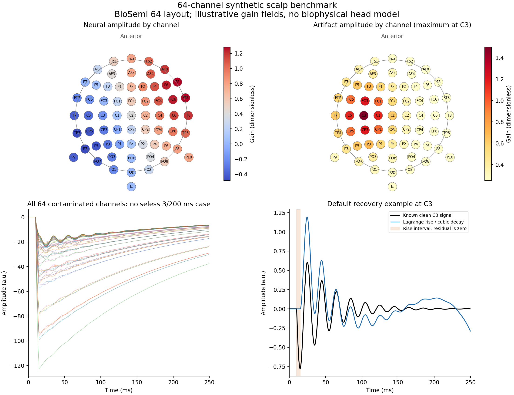

# Shared synthetic benchmark: 64 scalp channels

The multichannel benchmark contains **214 epochs x 64 EEG channels x 2,500
samples**: 13,696 channel traces sampled at 10 kHz from 0 to 249.9 ms. Each
epoch is a simulation condition, not a participant or an independent clinical
trial. Amplitudes are in arbitrary units (a.u.).



[Figure PDF](results/scalp64/scalp64_overview.pdf). Regenerate it from
`scripts/PythonPlugin` with `python plot_scalp_benchmark.py`.

## Signals and spatial structure

Every channel contains a known clean neural signal, a capacitive artifact and,
in the noisy cases, independent Gaussian noise:

`observed[case, channel, time] = neural_gain[channel] * oscillator[time] + artifact_gain[channel] * artifact[case, time] + noise[case, channel, time]`.

The underlying oscillator is `5 * exp(-25*u) * sin(2*pi*50*u)`, where
`u=max(t-0.010, 0)` seconds. Both artifact families start at 10 ms:

- **Windowed:** exponential rise followed by exponential decay, with a fixed
  artifact peak at 15 ms.
- **Multiplicative bi-exponential:** `(1-exp(-u/tau_rise))*exp(-u/tau_decay)`,
  with peak `10 ms + tau_rise*log(1+tau_decay/tau_rise)`.

The artifact base scale is -100 a.u. before applying the channel gain. Exact
temporal equations are in [PAPER_ALIGNMENT.md](PAPER_ALIGNMENT.md).

Channel names and angles use the BioSemi 64 montage distributed with
MNE-Python 1.13.2. Fiducials are excluded; Cz is an EEG channel. The angle
table and its BSD license are bundled with the generator. Coordinates are
projected onto an idealized sphere with radius 95 mm. For normalized position
`p=(x,y,z)`, the neural gain is `0.4+0.8*x+0.4*y`. The artifact gain is
`0.25+1.25*exp(-||p-p_C3||^2/0.5)`, a smooth field strongest at C3.

Consequently the 64 channels have different amplitudes and neural/artifact
ratios; they are not 64 identical copies. Noisy channels also have independent
noise. The same clean oscillator is projected across channels, and artifact
time constants are shared across channels within each case. There is no head
conductivity model, lead field, subject-specific electrode digitization,
average-reference operation or empirically calibrated EEG background. This is
a controlled multichannel numerical validation with an EEG-like channel count
and electrode layout, not a physiological validation on real scalp recordings.

## Composition of the 214 epochs

| Group | Cases per artifact family | Both families |
|---|---:|---:|
| Noiseless 10 x 10 grid | 100 | 200 |
| Exact 3/200 ms extreme, no noise | 1 | 2 |
| Extreme, noise SD 0.5 a.u., three replicates | 3 | 6 |
| Extreme, noise SD 2 a.u., three replicates | 3 | 6 |
| Total | 107 | 214 |

The grid uses 10 equally spaced rise constants from 1 to 50 ms and 10 decay
constants from 25 to 250 ms. Random streams use seed 42 and
`SeedSequence([seed, case_id, channel_id])`; changing worker count does not
change the generated signals. Case and channel IDs in CSV files are zero-based;
MATLAB array indices remain one-based. Noise is added independently at each
sample, including before the 10 ms onset.

## Five matched methods

The current default Lagrange-rise/cubic-decay method is included alongside the
four historical comparators: windowed exponential, polynomial 3/3, polynomial
3/5 and global bi-exponential. There are **68,480 reconstructed channel traces**
(`214 * 64 * 5`), including 54,784 for the four historical comparator models.
The new run uses the current exponential search setting of five refinements.

Both languages receive the same saved arrays and configurations. The known
artifact peak is supplied per case to isolate fitting behavior; this does not
test automatic peak detection. Lagrange subtraction zeroes the entire observed
rise segment, including its neural component. Recovery MSE is measured against
the clean channel-specific truth over 10.0-249.9 ms, with separate early and
late scores. Python/MATLAB agreement is checked over every output sample,
including the pre-onset interval, at an absolute tolerance of 1e-6 a.u.

## Local validation: 11 November 2026

All **68,480 reconstructed channel traces** passed the native Python/MATLAB
comparison over every sample. The maximum absolute difference was
**6.156852805361268e-12 a.u.**, below the 1e-6 tolerance. The largest difference
between exported recovery MSE values was **2.2026824808563106e-13 a.u.^2**.

| Method | Channel traces | Maximum absolute Python/MATLAB difference (a.u.) |
|---|---:|---:|
| Default Lagrange / cubic | 13,696 | 1.034e-12 |
| Windowed exponential | 13,696 | 9.948e-14 |
| Polynomial 3/3 | 13,696 | 1.034e-12 |
| Polynomial 3/5 | 13,696 | 6.157e-12 |
| Global bi-exponential | 13,696 | 3.126e-13 |

Validation used Python 3.12.10, NumPy 1.26.4, SciPy 1.15.2 and MATLAB R2023b
Update 6. All nine Python tests and the MATLAB core/EEGLAB tests passed. The
214 fixture checksums were verified, all 14 extreme/noisy cases were
regenerated exactly, and metric coverage was checked for missing/duplicate
case-channel-method combinations. MATLAB was run in 12 disjoint native
batches; all samples and channels were compared. Reports:
[agreement](results/scalp64/matlab/parity_report.json) and
[dataset/metric audit](results/scalp64/validation.json).

These agreement values measure implementation consistency, not physiological
accuracy of recovered neural activity.

## Reproduce

Git includes the generator code, channel description, configurations, seed,
figures, CSV/JSON reports and the compact binary `matlab_metrics.mat` summary.
The complete waveform arrays are excluded by `.gitignore`: `fixtures/*.mat`,
`metadata.mat` and `matlab/case_*_results.mat`. They remain on disk after a
local run and are not included in commits or pushes. A fresh clone therefore
requires the Python command below before running the MATLAB comparison.

From `scripts/PythonPlugin`, using the environment described in its README:

```bash
python run_scalp_benchmark.py --output ../results/scalp64 --workers 8
```

Worker count is optional (default 1) and can be reduced on smaller computers.
After Python completes, from `scripts/MatlabPlugin`:

```matlab
run_scalp_benchmark('../results/scalp64', '../results/scalp64/matlab')
```

MATLAB runs its native plugin on all cases and channels; it does not call Python.
For a command-line MATLAB run, `-singleCompThread` can reduce overhead for these
many small fits. An optional third argument selects zero-based case IDs, e.g.
`run_scalp_benchmark(inputDir, batchDir, 0:17)`. Use a different output directory
for each disjoint batch; a subset report covers only its selected cases.

## Saved files

The following files describe a generated local run. The dataset is split into
one MAT file per epoch to bound working memory; the waveform files marked
above are generated locally rather than downloaded with the repository:

- `metadata.mat`: times, channel names/positions, spatial gains and common
  clean truth `[64,2500]`, plus the ordered method names.
- `fixtures/case_000.mat` through `case_213.mat`: `data[1,64,2500]`,
  `python_recovered[5,64,2500]`, time constants, noise level, replicate, artifact
  family and supplied peak. Concatenating `data` along the first axis yields
  the complete `[214,64,2500]` dataset. The artifact and noise can be regenerated
  from the saved parameters and documented seed.
- `channels.csv`, `manifest.json`, `method_configs.json`, `summary.json`:
  geometry, case metadata, fixture SHA-256 hashes, configurations and dimensions.
  `summary.json` is written only after a successful complete Python run.
- `metrics.csv`: Python recovery metrics for every case/channel/method.
- `matlab/matlab_metrics.csv` and `matlab/parity_report.json`: native MATLAB
  recovery metrics and output differences for every case/channel/method.
  `matlab/matlab_metrics.mat` also retains the metrics in binary double precision.
- `validation.json`: fixture checksums, regeneration checks for all extreme
  cases, complete metric-key coverage and per-method agreement. Source hashes
  include a normalized-text variant that ignores line endings and end-of-file whitespace
  differences between development and repository copies.
- `matlab/case_*_results.mat`: native MATLAB waveforms for the two noiseless
  extreme cases. All 214 cases are compared; only these example waveforms are
  duplicated in the MATLAB results to limit storage.

The earlier single-channel benchmark and its saved figures remain in `results`.
Their 856 outputs and historical parity score describe that earlier run.
The 64-channel run has its own outputs under `results/scalp64`.

## Filling scope

This historical comparison explicitly uses `fill_mode="none"` in all methods.
It validates detrending before replacement. The current Gaussian default is
validated separately in [FILLING.md](FILLING.md).
